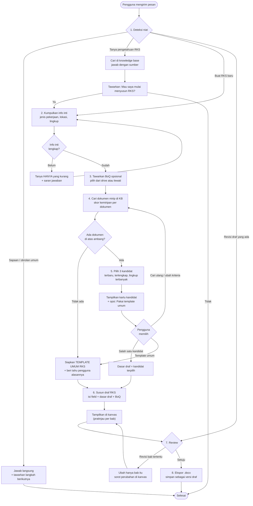
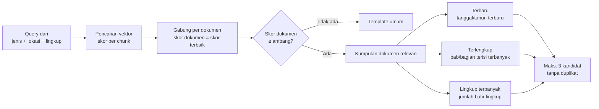
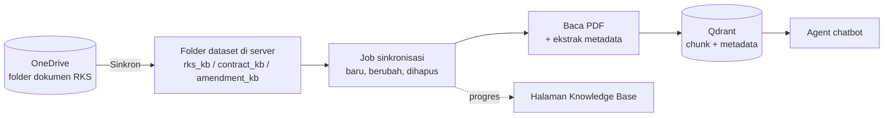
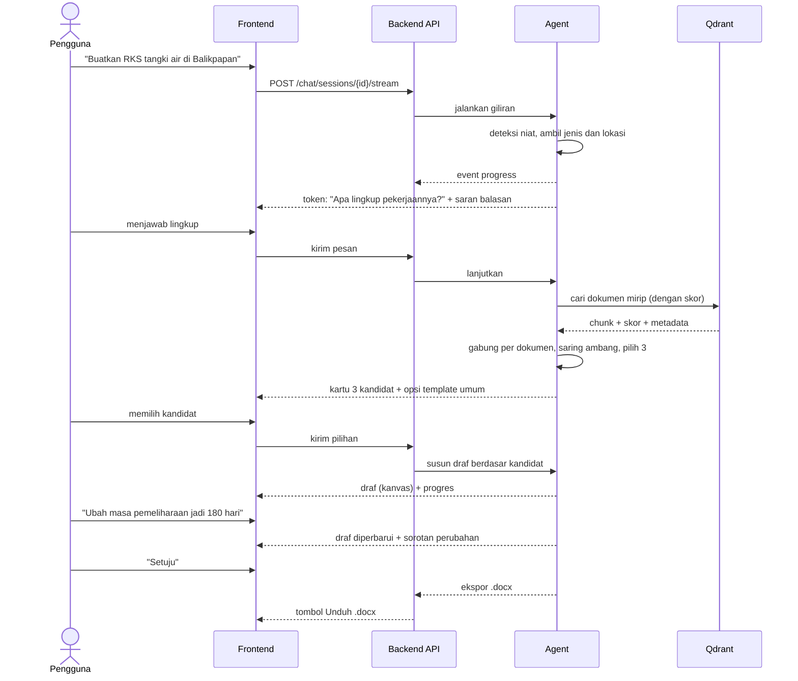

# Draft Flow v1 — Alur Kerja Chatbot RKS

Status: **draf desain, belum diimplementasi**. Disusun 23 Oktober 2026 dari 7 catatan arahan produk (lihat bagian 1).
Ini rancangan untuk didiskusikan, terutama bagian yang menyentuh mekanisme AI (ditandai **[AI]**) yang menjadi ranah tim AI. Bagian web ditandai **[Web]**.

---

## 1. Catatan arahan dan di mana ia masuk ke flow

| # | Catatan | Masuk ke flow di | Pemilik |
|---|---|---|---|
| 1 | Interaksi dinamis seperti chatbot pada umumnya | Prinsip interaksi (bagian 3) dan semua langkah | Web + AI |
| 2 | Tidak ada dokumen mirip: buat template umum | Langkah 4 (percabangan skor kemiripan) | AI |
| 3 | Ingest dari OneDrive | Alur data (bagian 5) | Web (+ keputusan akses) |
| 4 | RKS biasanya sudah ada lokasi dan lingkup | Langkah 2 (field inti yang dikumpulkan) | AI + Web |
| 5 | Search engine menampilkan 3 dokumen: terbaru, terlengkap, lingkup terbanyak | Langkah 4 (pemeringkatan kandidat) | AI (metadata) + Web (tampilan) |
| 6 | Tampilkan kandidat dokumen yang paling mendekati input pengguna | Langkah 4 dan 5 (kartu kandidat) | AI + Web |
| 7 | Buat flow alur kerja chatbot | Dokumen ini | — |

---

## 2. Alur utama

Ringkasan tahap:

| Tahap | Tujuan | Kondisi lanjut |
|---|---|---|
| 1. Deteksi niat | Menentukan jalur dari konteks percakapan, bukan hanya pesan terakhir | Selalu |
| 2. Info inti | Mengumpulkan jenis pekerjaan, **lokasi**, dan **lingkup** (catatan 4) | Ketiganya terisi |
| 3. BoQ opsional | Memperkaya lingkup dari BoQ di drive | Dipilih atau dilewati |
| 4. Cari mirip | Mengukur kemiripan dengan dokumen di knowledge base | Ada hasil di atas ambang, atau jatuh ke template umum |
| 5. Kandidat | Memilih dan menampilkan 3 kandidat yang bisa dibandingkan | Pengguna memilih satu atau template umum |
| 6. Susun draf | Menulis draf berdasar kandidat atau template | Draf tampil di kanvas |
| 7. Review | Revisi bertarget per bab, bisa berulang | Pengguna menyatakan setuju |
| 8. Ekspor | Menghasilkan `.docx` dan versi draf | Selesai |

---

## 3. Prinsip interaksi dinamis (catatan 1)

Tujuannya agar percakapan terasa seperti chatbot pada umumnya, bukan formulir bertahap.

1. **Bertanya seperlunya.** Agent membaca pesan dan mengambil semua info yang sudah disebut pengguna dalam satu kalimat. Hanya field yang masih kosong yang ditanyakan. Contoh: "RKS pembangunan tangki air di Balikpapan" sudah mengisi jenis pekerjaan dan lokasi, jadi agent hanya menanyakan lingkup.
2. **Boleh melompat.** Pengguna dapat mengganti topik, bertanya di tengah alur, atau berkata "ubah Bab III saja" tanpa memulai ulang. Niat dideteksi pada setiap pesan dengan memperhitungkan riwayat dan status alur.
3. **Selalu ada langkah berikutnya.** Setiap jawaban diakhiri tawaran yang relevan (misalnya "Mau saya mulai menyusun RKS-nya?"), tidak berhenti begitu saja.
4. **Saran balasan yang berubah.** Tombol saran di bawah kolom chat dihitung dari status alur dan field yang kosong, bukan daftar tetap.
5. **Progres terlihat.** Panel kecil menampilkan field yang sudah terisi dan yang belum, serta tahap yang sedang berjalan.
6. **Jawaban mengalir.** Teks di-stream per token. Tahap panjang (membaca BoQ, menyusun draf) menampilkan label progres.
7. **Terbuka terhadap koreksi.** Pengguna dapat mengubah isian sebelumnya kapan saja ("lokasinya ganti jadi Dumai"), dan draf yang terdampak ditandai.
8. **Jujur saat tidak tahu.** Bila tidak ada sumber yang cukup, agent mengatakannya lalu menawarkan jalan keluar (template umum), bukan menolak.

---

## 4. Detail langkah kunci

### 4.1 Info inti (catatan 4)

Field minimum yang dianggap inti untuk RKS:

| Field | Keterangan | Sumber isian |
|---|---|---|
| Jenis/judul pekerjaan | Apa yang dikerjakan | Pesan pengguna |
| Lokasi | Tempat pekerjaan | Pesan pengguna atau BoQ |
| Lingkup pekerjaan | Daftar atau uraian ruang lingkup | Pesan pengguna atau BoQ |

Field lain (nilai, durasi, risiko CSMS, dan seterusnya) bersifat lanjutan: ditanyakan setelah draf awal ada, atau diisi nilai baku yang bisa diubah pengguna.

Pertanyaan terbuka: apakah lokasi dan lingkup **wajib** sebelum pencarian dokumen, atau pencarian boleh jalan lebih dulu dengan info seadanya?

### 4.2 Pencarian dan pemeringkatan kandidat (catatan 2, 5, 6)

Aturan yang diusulkan:

1. **Relevansi dulu, peringkat kemudian.** Hanya dokumen yang cukup mirip dengan input pengguna masuk ke kumpulan. Tiga kriteria (terbaru, terlengkap, lingkup terbanyak) memilih **di dalam** kumpulan itu, supaya dokumen lama yang tidak relevan tidak muncul hanya karena "terbaru".
2. **Tanpa duplikat.** Bila satu dokumen menang di dua kriteria, slot yang kosong diisi dokumen peringkat berikutnya pada kriteria itu. Bila kumpulan kurang dari 3, tampilkan yang ada.
3. **Ambang kemiripan** menentukan jatuh ke template umum (catatan 2). Nilai ambang dikalibrasi dari dokumen nyata.
4. **Kartu kandidat** (catatan 6) menampilkan: nama dokumen, label kriteria ("Terbaru", "Terlengkap", "Lingkup terbanyak"), skor kemiripan, tahun, jumlah bab, jumlah butir lingkup, dan cuplikan yang cocok. Ditambah satu opsi tetap: **"Pakai template umum"**.

Metadata yang dibutuhkan per dokumen (disimpan saat ingest):

| Metadata | Dipakai untuk | Cara mendapatkan |
|---|---|---|
| Tanggal/tahun dokumen | Terbaru | Dari isi dokumen; cadangan: tanggal ubah berkas |
| Jumlah bab/bagian terdeteksi | Terlengkap | Dihitung dari struktur dokumen saat ingest |
| Jumlah butir lingkup | Lingkup terbanyak | Dihitung dari bagian Lingkup Pekerjaan saat ingest |
| Jenis pekerjaan, lokasi | Penyaring tambahan | Diekstrak saat ingest |

### 4.3 Template umum (catatan 2)

Dipakai ketika tidak ada dokumen yang cukup mirip, atau pengguna memilihnya. Aturan:

- Struktur baku Bab I sampai V (sama seperti struktur RKS yang sudah dihasilkan generator).
- Pengguna diberi tahu: "Belum ada dokumen yang mirip di knowledge base, jadi saya pakai template umum."
- Field inti (jenis, lokasi, lingkup) tetap diisi ke dalam template.
- Setelah draf jadi, tawarkan "Tambahkan dokumen contoh ke knowledge base" bagi peran yang berhak.

### 4.4 Revisi bertarget (catatan 1)

- Pengguna menyebut bagian: "ubah masa pemeliharaan jadi 180 hari" atau "perluas lingkup Bab III".
- Agent mengubah **hanya bagian itu**, lalu kanvas menyorot perubahannya.
- Riwayat versi tetap tersimpan, sehingga pengguna bisa kembali ke versi sebelumnya.

---

## 5. Alur data: ingest dari OneDrive (catatan 3)

Sisi web **sudah punya** job sinkronisasi dari folder lokal ke Qdrant (tombol "Sinkronkan Sekarang"). Yang perlu diputuskan adalah **cara folder OneDrive sampai ke folder dataset**:

| Opsi | Cara kerja | Kelebihan | Kekurangan |
|---|---|---|---|
| **A. Folder OneDrive tersinkron** | Aplikasi OneDrive di komputer/server menyinkronkan folder, lalu `DATASET_HOST_DIR` diarahkan ke sana | Paling sederhana, tanpa kode baru | Server harus punya OneDrive terpasang dan login; cocok untuk laptop demo |
| **B. Microsoft Graph API** | Backend membaca OneDrive/SharePoint langsung lewat Graph | Bisa berjalan di server tanpa aplikasi OneDrive, terjadwal | Perlu pendaftaran aplikasi di Entra ID (Azure AD), izin dari admin tenant, dan penyimpanan token |

Rekomendasi tahap awal: **opsi A**, karena tidak perlu izin admin tenant dan memakai job yang sudah ada. Opsi B dipertimbangkan bila aplikasi berjalan di VM tanpa antarmuka desktop.

Catatan: ingest hanya membaca PDF, dan nama berkas harus unik (lihat catatan tim AI A#6 dan A#7).

---

## 6. Urutan interaksi antarkomponen

---

## 7. Pemetaan ke sistem yang sudah ada

| Flow | Sudah ada | Perlu ditambah |
|---|---|---|
| Deteksi niat | `route_question` (3 rute: `kb`, `document_maker`, `direct`), keputusan per pesan tanpa riwayat | Niat revisi dan pilih kandidat; memperhitungkan riwayat dan status alur **[AI]** |
| Tanya pengetahuan | `retrieve_kb` + `kb_answer` | Tawaran lanjut ke penyusunan RKS **[AI]** |
| Info inti | `clarify_rks` (menanyakan field satu per satu) | Mengambil semua info dari satu pesan; hanya menanyakan yang kosong **[AI]** |
| BoQ | `upload_boq` + pemilih berkas dari drive | Tidak ada perubahan besar |
| Cari mirip | `retrieve_examples` (top-k tanpa skor, tanpa ambang) | Skor, penggabungan per dokumen, ambang **[AI]** |
| 3 kandidat | Belum ada | Metadata ingest (tanggal, kelengkapan, butir lingkup) **[AI]**; kartu kandidat di UI dan event baru **[Web]** |
| Template umum | Belum ada | Jalur template dan teksnya **[AI]** |
| Susun draf | `generate_rks_json` | Menerima kandidat terpilih sebagai dasar **[AI]** |
| Review dan revisi | `review_rks` (revisi mengulang generate; catatan F#2) | Revisi bertarget per bab **[AI]**; sorotan perubahan di kanvas **[Web]** |
| Ekspor | `export_docx` + unduh draf | Tidak ada perubahan besar |
| Saran balasan dan panel progres | Chip tetap per tahap | Saran dinamis dari status alur dan field kosong **[Web]** |
| Ingest | Job sinkronisasi dari folder lokal | Sumber OneDrive (bagian 5) **[Web]**; ekstraksi metadata **[AI]** |

---

## 8. Pertanyaan terbuka

Untuk tim AI:

1. Bagaimana skor kemiripan dihitung per dokumen (skor chunk terbaik, rata-rata, atau gabungan), dan berapa ambang awalnya?
2. Bagaimana "terlengkap" dan "lingkup terbanyak" diukur dari PDF, apakah dengan mendeteksi judul bab dan butir bernomor, atau dengan LLM saat ingest?
3. Dari mana tanggal dokumen diambil, dari isi dokumen atau dari tanggal berkas?
4. Apakah metadata baru ditambahkan di payload Qdrant, dan apakah dokumen yang sudah ter-ingest perlu di-ingest ulang?
5. Format draf: apakah kandidat terpilih dikirim sebagai teks sumber ke prompt, atau hanya struktur bab yang ditiru?
6. Isi template umum dan siapa yang menetapkannya.

Untuk pemilik produk:

1. Lokasi dan lingkup wajib terisi sebelum pencarian, atau pencarian boleh jalan lebih dulu?
2. Apakah tiga kriteria kandidat bisa diubah pengguna (misalnya "urutkan menurut terbaru saja")?
3. Apakah OneDrive yang dimaksud akun pribadi, Microsoft 365 organisasi, atau SharePoint? Ini menentukan opsi A atau B.
4. Apakah alur yang sama berlaku untuk Tender, Kontrak, dan Amendemen nanti, atau khusus RKS dulu?

---

## 9. Usulan tahapan pengerjaan

| Tahap | Isi | Pemilik |
|---|---|---|
| 1 | Isi knowledge base di Docker (folder dataset + sinkron); terapkan kunci LLM yang aktif | Web |
| 2 | Saran balasan dinamis, panel progres field, tombol hentikan/kirim ulang | Web |
| 3 | Ekstraksi metadata saat ingest (tanggal, kelengkapan, butir lingkup) | AI |
| 4 | Pencarian dengan skor, ambang, jalur template umum | AI |
| 5 | Event dan kartu 3 kandidat di UI | Web + AI |
| 6 | Router yang sadar riwayat; tawaran lanjut; revisi bertarget per bab | AI |
| 7 | Sumber OneDrive (opsi A, lalu B bila perlu) | Web |

Tahap 1 dan 2 dapat dimulai tanpa menunggu keputusan AI. Tahap 3 sampai 6 bergantung pada jawaban pertanyaan terbuka di bagian 8.
