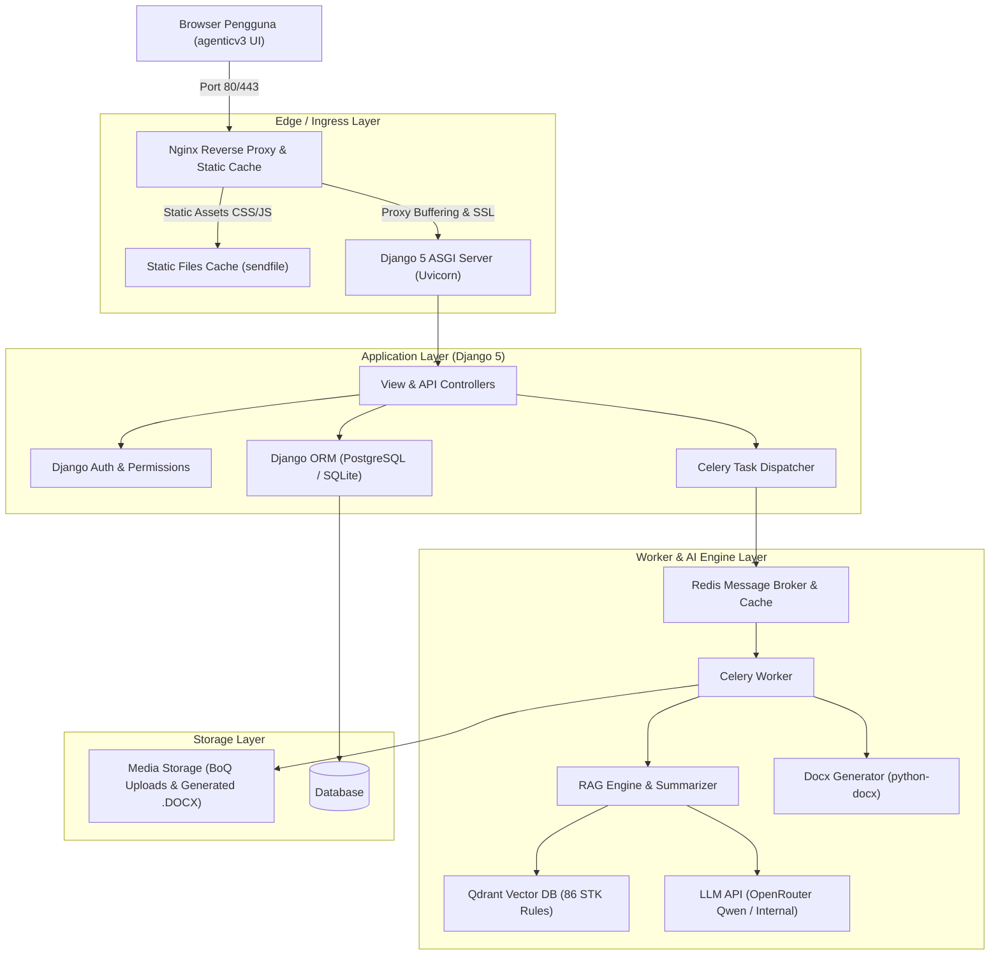
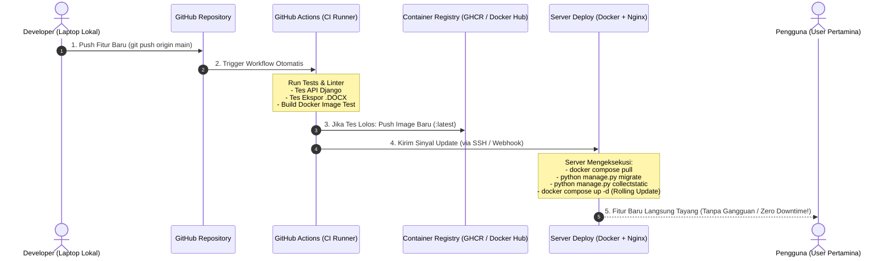

# Draft Perencanaan Proyek: Pertamina Procurement AI Copilot & Live Canvas
**Arsitektur Modern Django Monolith (Template & Static) + ASGI + Celery Worker + Nginx + CI/CD Pipeline**

---

## 1. Ringkasan Eksekutif & Tujuan Proyek

Proyek ini bertujuan mengintegrasikan antarmuka frontend modern **`agenticv3`** (berbasis *Claude-style Live Canvas*, *Progress Drawer*, dan *Vertical Docked Tab*) dengan backend **Django 5.x** modern. Sistem ini menggabungkan mesin RAG dan generator dokumen pengadaan dari `Agentic_Rag_Pertamina_camp` untuk menghasilkan dokumen pengadaan resmi PT Pertamina Patra Niaga (IKPP Versi 2.0 40 Poin, RKS, Kontrak Definitif, dan Amendemen) yang patuh terhadap Pedoman No. A03-001/PNG200000/2024-S9.

---

## 2. Arsitektur Sistem Terpadu



---

## 3. Struktur Direktori Proyek Target

```text
pertamina_procurement/
│
├── .github/                               # [CI/CD] Otomasi Pipeline
│   └── workflows/
│       ├── ci.yml                         # Uji otomatis (linter, unit test, build test)
│       └── deploy.yml                     # Deploy otomatis ke server produksi via SSH
│
├── manage.py                              # Entrypoint Django
├── requirements.txt                       # Dependensi Python
├── .env                                   # Kunci API, Qdrant, Redis, Database
├── Dockerfile                             # Build image Django + Worker
├── docker-compose.yml                     # Orkestrasi Nginx, Web, Celery, Redis, Qdrant
│
├── deploy/                                # Konfigurasi Server
│   ├── nginx/
│   │   └── default.conf                   # Reverse proxy, buffer upload besar, timeout 300s
│   └── supervisord.conf                   # (Opsional) jika multi-process dalam satu VM
│
├── core/                                  # Django Project Root
│   ├── __init__.py
│   ├── settings.py                        # ASGI, WhiteNoise (Plan B), Database, Celery
│   ├── urls.py                            # Master URL Routing
│   ├── asgi.py                            # ASGI Handler untuk Async & Streaming
│   └── wsgi.py
│
├── templates/                             # Integrasi Frontend agenticv3
│   └── index.html                         # Template utama (dengan tag )
│
├── static/                                # Aset Frontend agenticv3
│   ├── css/
│   │   ├── main.css                       # Layout, topbar, restore tab vertikal
│   │   ├── canvas.css                     # Live Canvas review dokumen
│   │   └── chat.css                       # Chat bubble, cards, drawer
│   ├── js/
│   │   ├── state.js                       # Store reactive state
│   │   ├── api.js                         # Fetch client (dengan CSRF token helper)
│   │   ├── chat.js                        # Controller interaksi chat & drawer
│   │   ├── canvas.js                      # Controller editor review dokumen
│   │   └── app.js                         # Bootstrap aplikasi
│   └── images/
│
├── apps/                                  # Modul Aplikasi Bisnis
│   ├── procurement/                       # Modul Manajemen Tender & API Endpoints
│   │   ├── models.py                      # TenderProject, DocumentDraft, ChatHistory
│   │   ├── views.py                       # def index(request)
│   │   ├── api_views.py                   # Async views untuk ekstraksi & ekspor
│   │   ├── urls.py
│   │   └── admin.py                       # Panel administrasi dokumen & kepatuhan
│   │
│   └── rag_engine/                        # Modul AI & RAG Pipeline (Porting)
│       ├── config.py                      # Konfigurasi model & koleksi STK
│       ├── vector_store.py                # Wrapper Qdrant
│       ├── summarizer.py                  # Parser PDF & BoQ Excel
│       ├── tender_generator.py            # Generator 40 Poin IKPP
│       ├── rks_generator.py               # Generator RKS & CSMS
│       ├── contract_generator.py          # Generator Kontrak & Amendemen
│       └── tasks.py                       # Celery tasks untuk background generation
│
└── media/                                 # Penyimpanan Berkas Dinamis
    ├── uploads/                           # Berkas BoQ / RKS acuan
    └── generated_docs/                    # Berkas .docx hasil generate
```

---

## 4. Desain Database & Kamus Data Lengkap (Database Specifications)

### 4.1 Entity Relationship Diagram (ERD)


### 4.2 Kamus Data & Spesifikasi Rinci Setiap Tabel

#### 1. Tabel: `procurement_tender_project`
* **Deskripsi:** Menyimpan entitas utama paket pekerjaan tender/pengadaan yang sedang disusun oleh Pejabat Pembuat Komitmen (PPK) atau Tim Pengadaan.
* **Tabel Spesifikasi:**

| Nama Kolom | Tipe Data | Constraint | Keterangan & Aturan Bisnis |
| :--- | :--- | :--- | :--- |
| `id` | `UUID` | `PRIMARY KEY`, Default: `uuid4()` | Pengenal unik proyek tender |
| `user_id` | `INTEGER` | `FOREIGN KEY` -> `auth_user.id`, `ON DELETE SET NULL`, Nullable | Akun pegawai / PPK pembuat proyek |
| `no_tender` | `VARCHAR(100)` | `UNIQUE`, `INDEX`, Nullable | Nomor resmi paket tender (misal: `PR-2026-PN-0042`) |
| `nama_pengadaan` | `VARCHAR(255)` | `NOT NULL` | Nama paket pengadaan barang/jasa |
| `tipe_dokumen` | `VARCHAR(50)` | `NOT NULL`, Default: `'tender'` | Pilihan: `'tender'` (IKPP 2.0), `'rks'`, `'kontrak'`, `'amendemen'` |
| `hps_total` | `DECIMAL(18,2)` | `NOT NULL`, Default: `0.00` | Nilai Total Harga Perkiraan Sendiri (Rupiah) |
| `resiko_csms` | `VARCHAR(20)` | `NOT NULL`, Default: `'Tinggi'` | Tingkat risiko K3L: `'Ekstrim'`, `'Tinggi'`, `'Sedang'`, `'Rendah'` |
| `status_tahap` | `VARCHAR(50)` | `NOT NULL`, Default: `'DRAFT'` | Status alur: `'DRAFT'`, `'EKSTRAKSI'`, `'REVIEW_CANVAS'`, `'PUBLISHED'` |
| `current_step` | `SMALLINT` | `NOT NULL`, Default: `1` | Indikator tahap 1-4 pada Progress Drawer UI |
| `metadata_ekstraksi` | `JSONB` | Nullable, Default: `{}` | Parameter hasil parsing BoQ/TOR (jangka waktu, jaminan, denda) |
| `created_at` | `TIMESTAMP WITH TIME ZONE` | `NOT NULL`, Auto-now-add | Waktu inisiasi sesi proyek |
| `updated_at` | `TIMESTAMP WITH TIME ZONE` | `NOT NULL`, Auto-now | Waktu pembaruan terakhir |

---

#### 2. Tabel: `procurement_document_draft`
* **Deskripsi:** Menyimpan versi dan draf dokumen Microsoft Word (`.docx`) yang dihasilkan oleh sistem AI / diekspor pengguna. Mendukung *versioning* (v1.0, v2.0, dll).
* **Tabel Spesifikasi:**

| Nama Kolom | Tipe Data | Constraint | Keterangan & Aturan Bisnis |
| :--- | :--- | :--- | :--- |
| `id` | `UUID` | `PRIMARY KEY`, Default: `uuid4()` | Pengenal unik draf dokumen |
| `project_id` | `UUID` | `FOREIGN KEY` -> `procurement_tender_project.id`, `ON DELETE CASCADE` | Relasi ke paket tender pemilik |
| `versi` | `VARCHAR(20)` | `NOT NULL`, Default: `'v1.0'` | Label versi dokumen (misal: `'v1.0'`, `'v2.0-revisi'`) |
| `judul_dokumen` | `VARCHAR(255)` | `NOT NULL` | Judul berkas formal (misal: `Dokumen_Tender_IKPP_v2.0.docx`) |
| `file_docx_path` | `VARCHAR(500)` | Nullable | Path relatif penyimpanan file Word di folder `media/generated_docs/` |
| `skor_kepatuhan_stk` | `SMALLINT` | `NOT NULL`, Default: `100` | Skor kesesuaian terhadap 86 aturan STK (rentang 0 - 100) |
| `is_active` | `BOOLEAN` | `NOT NULL`, Default: `TRUE` | Menandai versi draf yang sedang aktif di Live Canvas |
| `status_approval` | `VARCHAR(30)` | `NOT NULL`, Default: `'DRAFT'` | Pilihan: `'DRAFT'`, `'MENUNGGU_REVIEW'`, `'DISETUJUI'`, `'DITOLAK'` |
| `created_at` | `TIMESTAMP WITH TIME ZONE` | `NOT NULL`, Auto-now-add | Waktu pembuatan versi dokumen |
| `updated_at` | `TIMESTAMP WITH TIME ZONE` | `NOT NULL`, Auto-now | Waktu modifikasi terakhir |

---

#### 3. Tabel: `procurement_document_clause`
* **Deskripsi:** Menyimpan rincian tiap pasal/klausul (40 Poin IKPP & Kontrak) secara granular sehingga dapat diedit satu per satu di Live Canvas editor.
* **Tabel Spesifikasi:**

| Nama Kolom | Tipe Data | Constraint | Keterangan & Aturan Bisnis |
| :--- | :--- | :--- | :--- |
| `id` | `UUID` | `PRIMARY KEY`, Default: `uuid4()` | Pengenal unik pasal/klausul |
| `draft_id` | `UUID` | `FOREIGN KEY` -> `procurement_document_draft.id`, `ON DELETE CASCADE` | Relasi ke draf dokumen induk |
| `nomor_urut` | `INTEGER` | `NOT NULL` | Urutan tampilan bab/pasal (1 s.d. 40+) |
| `kode_pasal` | `VARCHAR(50)` | `NOT NULL` | Kode referensi pasal (misal: `'IKPP-01'`, `'KONTRAK-PASAL-14'`) |
| `judul_pasal` | `VARCHAR(255)` | `NOT NULL` | Judul klausul (misal: `Masa Pemeliharaan & Garansi`) |
| `teks_original` | `TEXT` | `NOT NULL` | Teks acuan baku standar Pertamina |
| `teks_revisi_ai` | `TEXT` | `NOT NULL` | Teks hasil sintesis Copilot sesuai konteks proyek |
| `is_edited_manual` | `BOOLEAN` | `NOT NULL`, Default: `FALSE` | Menandai apakah klausul telah diedit manual oleh PPK di canvas |
| `status_verifikasi` | `VARCHAR(30)` | `NOT NULL`, Default: `'COMPLIANT'` | Status kesesuaian: `'COMPLIANT'`, `'WARNING'`, `'DEVIATED'` |
| `catatan_stk` | `TEXT` | Nullable | Rujukan pasal Pedoman A03-001 yang mendasari klausul ini |
| `updated_at` | `TIMESTAMP WITH TIME ZONE` | `NOT NULL`, Auto-now | Waktu pembaruan teks klausul |

---

#### 4. Tabel: `procurement_uploaded_attachment`
* **Deskripsi:** Menyimpan data berkas acuan yang diunggah pengguna (Bill of Quantities Excel, RKS teknis PDF, Kerangka Acuan Kerja).
* **Tabel Spesifikasi:**

| Nama Kolom | Tipe Data | Constraint | Keterangan & Aturan Bisnis |
| :--- | :--- | :--- | :--- |
| `id` | `UUID` | `PRIMARY KEY`, Default: `uuid4()` | Pengenal unik berkas unggahan |
| `project_id` | `UUID` | `FOREIGN KEY` -> `procurement_tender_project.id`, `ON DELETE CASCADE` | Relasi ke paket pengadaan |
| `tipe_berkas` | `VARCHAR(30)` | `NOT NULL` | Kategori: `'BOQ_EXCEL'`, `'RKS_PDF'`, `'TOR_KAK'`, `'GAMBAR_TEKNIK'` |
| `nama_file_asli` | `VARCHAR(255)` | `NOT NULL` | Nama asli berkas saat diunggah oleh pengguna |
| `file_path` | `VARCHAR(500)` | `NOT NULL` | Lokasi fisik berkas di storage `media/uploads/` |
| `ukuran_bytes` | `BIGINT` | `NOT NULL` | Ukuran berkas dalam byte |
| `hash_md5` | `VARCHAR(32)` | `INDEX` | Hash checksum untuk mencegah duplikasi berkas identik |
| `hasil_ekstraksi_json` | `JSONB` | Nullable, Default: `{}` | Hasil pembacaan teks / tabel oleh parser `summarizer.py` |
| `uploaded_at` | `TIMESTAMP WITH TIME ZONE` | `NOT NULL`, Auto-now-add | Waktu berkas selesai diunggah |

---

#### 5. Tabel: `procurement_chat_session`
* **Deskripsi:** Mewadahi satu sesi interaksi tanya jawab antara pengguna dengan Copilot AI untuk suatu proyek pengadaan.
* **Tabel Spesifikasi:**

| Nama Kolom | Tipe Data | Constraint | Keterangan & Aturan Bisnis |
| :--- | :--- | :--- | :--- |
| `id` | `UUID` | `PRIMARY KEY`, Default: `uuid4()` | Pengenal unik sesi chat |
| `project_id` | `UUID` | `FOREIGN KEY` -> `procurement_tender_project.id`, `ON DELETE CASCADE` | Relasi ke proyek pengadaan terkait |
| `judul_sesi` | `VARCHAR(150)` | `NOT NULL`, Default: `'Penyusunan Dokumen Tender'` | Judul topik sesi obrolan |
| `is_active` | `BOOLEAN` | `NOT NULL`, Default: `TRUE` | Menandai sesi percakapan yang sedang terbuka di UI |
| `created_at` | `TIMESTAMP WITH TIME ZONE` | `NOT NULL`, Auto-now-add | Waktu inisiasi sesi percakapan |

---

#### 6. Tabel: `procurement_chat_message`
* **Deskripsi:** Menyimpan setiap baris percakapan chat, log *tool-calls* (seperti `check_stk_compliance`, `update_clause`), dan metadata artifact yang ditampilkan pada bubble chat.
* **Tabel Spesifikasi:**

| Nama Kolom | Tipe Data | Constraint | Keterangan & Aturan Bisnis |
| :--- | :--- | :--- | :--- |
| `id` | `UUID` | `PRIMARY KEY`, Default: `uuid4()` | Pengenal unik pesan |
| `session_id` | `UUID` | `FOREIGN KEY` -> `procurement_chat_session.id`, `ON DELETE CASCADE` | Relasi ke sesi obrolan induk |
| `role` | `VARCHAR(20)` | `NOT NULL` | Pengirim: `'user'`, `'assistant'`, `'system'` |
| `content` | `TEXT` | `NOT NULL` | Teks isi pesan |
| `tool_calls` | `JSONB` | Nullable | Parameter panggilan alat bantu AI (klausul yang diubah, query RAG) |
| `artifacts_payload` | `JSONB` | Nullable | Data card interaktif yang dirender di bubble chat |
| `prompt_tokens` | `INTEGER` | Nullable, Default: `0` | Jumlah token prompt input (untuk monitoring biaya LLM) |
| `completion_tokens` | `INTEGER` | Nullable, Default: `0` | Jumlah token respons (untuk monitoring throughput) |
| `created_at` | `TIMESTAMP WITH TIME ZONE` | `NOT NULL`, Auto-now-add | Waktu pesan dikirimkan |

---

#### 7. Tabel: `procurement_stk_rule`
* **Deskripsi:** Katalog referensi aturan baku **Pedoman Pengadaan No. A03-001/PNG200000/2024-S9** (86 aturan STK) yang tersinkronisasi dengan Qdrant Vector Store.
* **Tabel Spesifikasi:**

| Nama Kolom | Tipe Data | Constraint | Keterangan & Aturan Bisnis |
| :--- | :--- | :--- | :--- |
| `id` | `INTEGER` | `PRIMARY KEY`, Auto-increment | ID aturan |
| `kode_pedoman` | `VARCHAR(50)` | `NOT NULL`, Default: `'A03-001/2024-S9'` | Nomor surat pedoman pengadaan acuan |
| `nomor_aturan` | `VARCHAR(20)` | `UNIQUE`, `INDEX` | Kode nomor aturan (misal: `'STK-01'`, `'STK-44'`) |
| `kategori_stk` | `VARCHAR(50)` | `NOT NULL` | Kategori (misal: `'Jaminan'`, `'K3L CSMS'`, `'Denda'`, `'TKDN'`) |
| `judul_aturan` | `VARCHAR(255)` | `NOT NULL` | Judul singkat aturan |
| `deskripsi_aturan` | `TEXT` | `NOT NULL` | Penjelasan ketentuan hukum & operasional pengadaan |
| `klausul_baku_docx` | `TEXT` | Nullable | Bunyi kalimat resmi yang wajib masuk ke dalam template Word |
| `level_kepatuhan` | `VARCHAR(20)` | `NOT NULL`, Default: `'MANDATORY'` | Sifat aturan: `'MANDATORY'` (Wajib mutlak) atau `'OPTIONAL'` |
| `qdrant_point_id` | `VARCHAR(64)` | Nullable, `INDEX` | ID vektor embeddings terkait di koleksi Qdrant |
| `updated_at` | `TIMESTAMP WITH TIME ZONE` | `NOT NULL`, Auto-now | Waktu pembaruan aturan |

---

#### 8. Tabel: `procurement_audit_trail`
* **Deskripsi:** Mencatat riwayat audit resmi (*compliance audit log*) dari seluruh tindakan penting pengguna dan perubahan pasal dokumen sesuai standar kepatuhan BUMN.
* **Tabel Spesifikasi:**

| Nama Kolom | Tipe Data | Constraint | Keterangan & Aturan Bisnis |
| :--- | :--- | :--- | :--- |
| `id` | `BIGINT` | `PRIMARY KEY`, Auto-increment | ID entri log |
| `project_id` | `UUID` | `FOREIGN KEY` -> `procurement_tender_project.id`, `ON DELETE CASCADE` | Relasi ke paket pengadaan |
| `user_id` | `INTEGER` | `FOREIGN KEY` -> `auth_user.id`, Nullable | Pengguna yang melakukan tindakan |
| `tipe_aksi` | `VARCHAR(50)` | `NOT NULL`, `INDEX` | Jenis aksi: `'UPLOAD_BOQ'`, `'GENERATE_DOCX'`, `'REVISI_PASAL'`, `'EXPORT_DOKUMEN'` |
| `modul_terkait` | `VARCHAR(50)` | `NOT NULL` | Modul yang disentuh: `'CANVAS'`, `'CHAT'`, `'EXPORTER'`, `'AUTH'` |
| `rincian_perubahan` | `TEXT` | `NOT NULL` | Detail perubahan (misal: "Ubah Masa Pemeliharaan dari 90 menjadi 180 hari") |
| `ip_address` | `VARCHAR(45)` | Nullable | Alamat IP jaringan pengguna |
| `recorded_at` | `TIMESTAMP WITH TIME ZONE` | `NOT NULL`, Auto-now-add | Waktu pencatatan jejak audit |

---

### 4.3 Aturan Integritas Data & Indeks (*Database Indexing*)
1. **Foreign Key Cascading**:
   * Jika sebuah proyek tender (`procurement_tender_project`) dihapus, maka seluruh draf dokumen, klausul, riwayat chat, dan catatan auditnya otomatis dibersihkan (`ON DELETE CASCADE`).
2. **Kueri Berkecepatan Tinggi (Indexing)**:
   * Kolom pencarian cepat seperti `no_tender`, `hash_md5`, `qdrant_point_id`, dan `tipe_aksi` dilengkapi indeks database B-Tree.
3. **Format Field JSONB**:
   * Digunakan untuk kolom `metadata_ekstraksi`, `tool_calls`, dan `hasil_ekstraksi_json` pada PostgreSQL agar dapat dikueri langsung menggunakan operator JSON bawaan (`->`, `->>`) dengan latensi < 1 ms.

---

## 5. Tahapan Implementasi (Rencana Kerja 5 Fase)

### Fase 1: Inisialisasi & Skafolding Django Monolith
- [ ] Inisialisasi Django 5 project (`pertamina_procurement`) dengan dependensi inti.
- [ ] Pindahkan `agenticv3/index.html` ke `templates/index.html`, tambahkan tag ``.
- [ ] Pindahkan folder `css/` dan `js/` ke `static/`.
- [ ] Pasang **WhiteNoise** di `settings.py` sebagai *Plan B* (garansi static files berjalan instan tanpa Nginx).
- [ ] Sesuaikan `api.js` agar secara otomatis membaca cookie `csrftoken` dan menyuntikkannya ke header `X-CSRFToken`.

### Fase 2: Implementasi Database & Model ORM
- [ ] Definisikan skema model `TenderProject`, `DocumentDraft`, dan `ChatMessage` di `apps/procurement/models.py`.
- [ ] Jalankan migrasi awal (`python manage.py makemigrations && python manage.py migrate`).
- [ ] Daftarkan model ke Django Admin (`admin.py`) untuk kemudahan audit dan inspeksi data dokumen.

### Fase 3: Porting Modul AI & RAG Pipeline
- [ ] Pindahkan logic dari `Agentic_Rag_Pertamina_camp` (`RAG/`, `tender/`, `contract/`) ke `apps/rag_engine/`.
- [ ] Implementasikan endpoint Async di `apps/procurement/api_views.py`:
  - `POST /api/extract-tender-metadata/`
  - `POST /api/generate-tender/`
  - `POST /api/generate-rks/`
  - `POST /api/generate-kontrak/`
  - `POST /api/generate-amendemen/`
  - `GET /api/health/`
- [ ] Verifikasi format unduhan `.docx` dengan template styling resmi Pertamina.

### Fase 4: Konfigurasi Celery Worker & Streaming Token
- [ ] Pasang Celery dengan Redis broker untuk pemrosesan file `.docx` berat.
- [ ] Hubungkan indikator progres frontend (*Progress Drawer* & *Live Sync Badge*) dengan status task worker.
- [ ] (Opsional) Implementasikan `StreamingHttpResponse` untuk streaming token jawaban AI per kata.

### Fase 5: Dockerization, Nginx, & Pipeline CI/CD Siap Deploy
- [ ] Susun `Dockerfile` multi-stage untuk Django ASGI & Celery.
- [ ] Buat file konfigurasi `nginx.conf`:
  - `client_max_body_size 100M;` (upload BoQ besar aman).
  - `proxy_read_timeout 300s;` (mencegah timeout saat LLM berpikir).
  - `proxy_buffering off;` (mendukung streaming AI instan).
- [ ] Buat `docker-compose.yml` yang menghubungkan service: `nginx`, `web`, `celery_worker`, `redis`, dan `qdrant`.
- [ ] Siapkan workflow `.github/workflows/deploy.yml` untuk otomatisasi testing & rilis.
- [ ] Uji coba skenario *end-to-end* (Upload BoQ -> Ekstraksi AI -> Edit Canvas -> Generate Dokumen -> Unduh .docx).

---

## 6. Matrix Mitigasi Risiko & Cadangan Solusi

| Potensi Kendala | Risiko | Solusi Mitigasi |
| :--- | :--- | :--- |
| **Server belum siap Docker** | Deployment tertunda | Aktifkan **WhiteNoise + Gzip/Brotli** di `settings.py`. Aplikasi langsung bisa dijalankan dengan `python manage.py runserver` atau Gunicorn/Uvicorn tunggal. |
| **Ekstraksi BoQ Excel memakan waktu lama** | Browser mengalami timeout | Celery worker menangani parsing di background dan mengirimkan sinyal progres ke frontend. |
| **CSRF Token Blocking pada AJAX Fetch** | Request `POST` ditolak (HTTP 403) | `api.js` dilengkapi helper fungsi ekstraksi cookie CSRF Django secara otomatis. |
| **Koneksi LLM terputus di tengah jalan** | Dokumen gagal terbentuk utuh | Logika *retry mechanism* (maksimal 3 kali) pada `rag_engine` sebelum melaporkan error ke chat window. |

---

## 7. Strategi CI/CD & Alur Penambahan Fitur Baru

### 7.1 Diagram Siklus CI/CD


### 7.2 Siklus Penambahan Fitur Baru (Developer Workflow)
Setiap penambahan fitur baru (misalnya: penambahan evaluasi otomatis skor CSMS vendor, penyesuaian pasal STK baru, atau pembaruan UI canvas) mengikuti alur terstandarisasi:

1. **Lokal (Branching & Development)**:
   - Developer membuat branch fitur baru: `git checkout -b feature/nama-fitur`.
   - Mengubah skema model di `apps/procurement/models.py`, menjalankan `python manage.py makemigrations`.
   - Menulis/memperbarui komponen UI di `templates/` atau `static/`.
   - Menjalankan unit test lokal: `python manage.py test`.
2. **Pull Request & Continuous Integration (CI)**:
   - Developer mem-push branch ke GitHub dan membuka Pull Request (PR) ke `main`.
   - GitHub Actions otomatis menjalankan:
     - **Linting & Code Style**: Memastikan kode memenuhi standar PEP8 / formatting bersih.
     - **Django Unit Tests**: Memverifikasi model, serializers, dan views API.
     - **Document Generator Test**: Memastikan fungsi ekspor `.docx` menghasilkan berkas Word yang valid tanpa korupsi XML.
     - **Docker Build Check**: Memastikan image Docker berhasil di-build tanpa missing dependency.
   - PR hanya dapat di-merge jika seluruh pengujian berstatus **HIJAU (PASS)**.
3. **Continuous Deployment (CD) ke Server**:
   - Setelah branch di-merge ke `main`, GitHub Actions mentrigger proses deployment:
     - Mem-build image final dengan tag versi rilis (misal `v1.2.0` dan `latest`).
     - Melakukan koneksi SSH aman ke server staging/production.
     - Menjalankan rolling update:
       ```bash
       docker compose pull web celery_worker
       docker compose run --rm web python manage.py migrate
       docker compose run --rm web python manage.py collectstatic --noinput
       docker compose up -d --no-deps web celery_worker
       ```
     - Nginx secara mulus meneruskan request baru ke container versi anyar (*zero-downtime*).

### 7.3 Manajemen Database & Ketahanan Data (Zero Data Loss)
- **Persistensi Data**: Database (PostgreSQL / SQLite) dan folder berkas upload (`media/`) disimpan pada **Docker Volume** di disk fisik server, terisolasi dari container aplikasi. Container dapat di-rebuild berulang kali tanpa risiko kehilangan berkas pengadaan atau riwayat chat.
- **Migrasi Non-Destruktif**: Migrasi schema (`manage.py migrate`) menerapkan penambahan kolom/tabel secara inkremental tanpa menghapus data yang sudah ada.

### 7.4 Spesifikasi Konfigurasi GitHub Actions (`.github/workflows/deploy.yml`)
```yaml
name: CI/CD Pertamina Copilot

on:
  push:
    branches: [ "main" ]

jobs:
  test:
    name: Run Automated Tests
    runs-on: ubuntu-latest
    steps:
      - uses: actions/checkout@v4
      - name: Setup Python
        uses: actions/setup-python@v5
        with:
          python-version: '3.11'
      - name: Install Dependencies
        run: |
          pip install -r requirements.txt
      - name: Run Django Tests
        run: |
          python manage.py test

  deploy:
    name: Deploy to Server
    needs: test
    runs-on: ubuntu-latest
    if: github.ref == 'refs/heads/main'
    steps:
      - name: Deploy via SSH
        uses: appleboy/ssh-action@master
        with:
          host: ${{ secrets.SERVER_HOST }}
          username: ${{ secrets.SERVER_USER }}
          key: ${{ secrets.SERVER_SSH_KEY }}
          script: |
            cd /opt/pertamina-procurement
            git pull origin main
            docker compose build
            docker compose run --rm web python manage.py migrate
            docker compose run --rm web python manage.py collectstatic --noinput
            docker compose up -d
```
