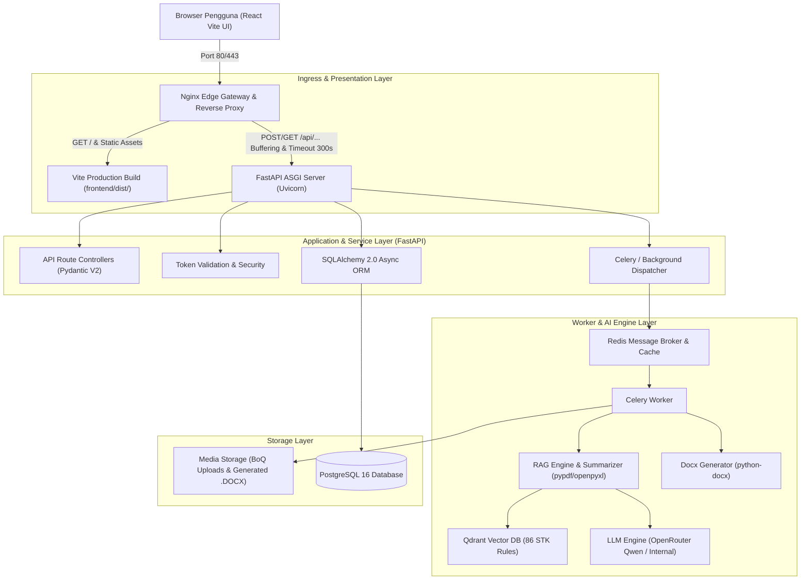
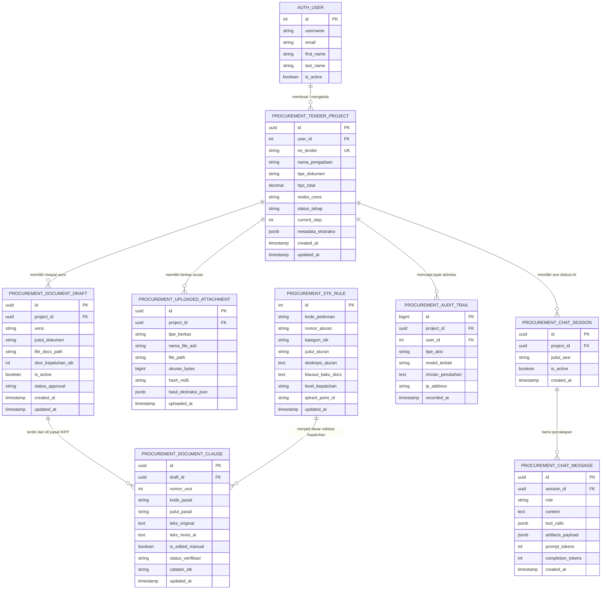
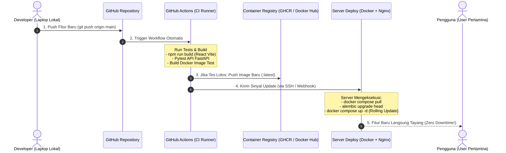

# Draft Perencanaan Proyek: Pertamina Procurement AI Copilot & Live Canvas
**Arsitektur Modern Decoupled: Frontend React (Vite JavaScript) + Backend FastAPI (ASGI) + SQLAlchemy 2.0 + Celery + Nginx Reverse Proxy + CI/CD Docker**

---

## 1. Ringkasan Eksekutif & Tujuan Proyek

Proyek ini bertujuan mengintegrasikan antarmuka frontend modern berbasis **React + Vite (JavaScript)** dengan arsitektur komponen modular di dalam folder **`komponen/`**, terhubung ke backend **FastAPI (Python 3.11/3.12)** yang berkinerja tinggi (*high-concurrency async*).

Sistem ini mengadopsi **Opsi A (Nginx Reverse Proxy Decoupled)**, di mana:
1. **Frontend React (Vite JavaScript)**: Seluruh elemen antarmuka (*Claude-style Live Canvas*, *Progress Drawer*, *Vertical Docked Tab*, *Chat & In-Chat Artifact Cards*, *Tool-calls Accordion*, dan *DocPicker Modal*) dipecah menjadi komponen-komponen independen dan dapat digunakan kembali (*reusable components*) di dalam direktori `frontend/src/komponen/`. Pada mode produksi, Vite mengompilasi bundel statis ke folder `dist/` yang disajikan langsung oleh Nginx dengan latensi < 2 ms.
2. **Backend FastAPI**: Beroperasi sebagai layanan ASGI mandiri di port internal 8000 untuk menangani komputasi AI, validasi Pydantic v2, *token streaming* (Server-Sent Events), koneksi Qdrant Vector DB, serta pembentukan dokumen resmi PT Pertamina Patra Niaga (IKPP Versi 2.0 40 Poin, RKS, Kontrak Definitif, dan Amendemen) yang patuh terhadap Pedoman No. A03-001/PNG200000/2024-S9.
3. **SQLAlchemy 2.0 (Async) + Alembic**: Menangani persistensi data relasional ke PostgreSQL untuk 8 tabel pengadaan, riwayat chat, dan audit kepatuhan.

---

## 2. Arsitektur Sistem Terpadu (Opsi A: Decoupled via Nginx)



---

## 3. Struktur Direktori Proyek Target

```text
pertamina_procurement/
│
├── .github/                               # [CI/CD] Otomasi Pipeline
│   └── workflows/
│       ├── ci.yml                         # Uji otomatis (React build, Pytest FastAPI, Docker test)
│       └── deploy.yml                     # Deploy otomatis via SSH ke server produksi
│
├── deploy/                                # Konfigurasi Server
│   └── nginx/
│       └── default.conf                   # Reverse proxy, static server dist/, timeout 300s
│
├── frontend/                              # [FRONTEND REACT + VITE JAVASCRIPT]
│   ├── index.html                         # Entry point HTML Vite
│   ├── package.json                       # Dependensi React, Vite, Lucide-React, Axios
│   ├── vite.config.js                     # Konfigurasi build & proxy dev /api/ -> :8000
│   ├── public/                            # Aset publik statis (favicon, logo Pertamina)
│   └── src/
│       ├── main.jsx                       # React DOM entry point
│       ├── App.jsx                        # Root Layout (Split-screen Chat & Live Canvas)
│       ├── App.css
│       ├── index.css                      # Global styles & design tokens resmi Pertamina
│       │
│       ├── komponen/                      # [FOLDER KOMPONEN MODULAR]
│       │   ├── Navbar/
│       │   │   ├── Navbar.jsx             # Topbar, Logo Pertamina, Ganti Dokumen, Step & Unduh
│       │   │   ├── HamburgerMenu.jsx      # Dropdown menu pengaturan & riwayat pengadaan
│       │   │   └── Navbar.css
│       │   │
│       │   ├── Chat/
│       │   │   ├── ChatPanel.jsx          # Panel chat kiri (auto 100% saat canvas off)
│       │   │   ├── ChatBubble.jsx         # Pesan percakapan user & balasan AI
│       │   │   ├── ToolCallCard.jsx       # Card interaktif eksekusi tool AI (klausul STK)
│       │   │   ├── ArtifactCard.jsx       # Card embed preview dokumen di dalam chat
│       │   │   ├── QuickActionChips.jsx   # Tombol saran prompt cepat (Jaminan, CSMS, HPS)
│       │   │   ├── ChatInput.jsx          # Textarea input & tombol kirim (send button)
│       │   │   └── Chat.css
│       │   │
│       │   ├── Canvas/
│       │   │   ├── CanvasReview.jsx       # Panel review dokumen kanan (Live Canvas)
│       │   │   ├── CanvasToolbar.jsx      # Tabs (Dokumen, Matriks CSMS, STK 86) & Icon Tools
│       │   │   ├── DocumentEditor.jsx     # Editor interaktif klausul / markdown dokumen
│       │   │   ├── CsmsMatrixView.jsx     # Tampilan visual matriks evaluasi risiko CSMS
│       │   │   ├── StkComplianceView.jsx  # Checklist kepatuhan 86 aturan STK Pertamina
│       │   │   └── Canvas.css
│       │   │
│       │   ├── Common/
│       │   │   ├── VerticalRestoreTab.jsx # Tab vertikal samping kanan pembuka kembali canvas
│       │   │   ├── ProgressDrawer.jsx     # Drawer slide-out 'Step 1 of 4' & resource acuan
│       │   │   ├── DocPickerModal.jsx     # Modal popup pemilihan 4 paket dokumen tender
│       │   │   ├── Toast.jsx              # Notifikasi pop-up feedback status / error
│       │   │   └── Common.css
│       │   │
│       │   └── index.js                   # Barrel export seluruh komponen
│       │
│       ├── services/                      # Komunikasi API & State
│       │   ├── api.js                     # Axios/Fetch client ke endpoint FastAPI
│       │   └── useAppStore.js             # State management global (Zustand / Context)
│       │
│       └── assets/                        # Logo SVG, icon, dan styling tambahan
│
├── backend/                               # [BACKEND FASTAPI ASGI]
│   ├── app/
│   │   ├── __init__.py
│   │   ├── main.py                        # Entrypoint FastAPI (CORS, routers, lifecycle)
│   │   ├── config.py                      # Pydantic BaseSettings (.env, Qdrant URL, DB URL)
│   │   ├── database.py                    # SQLAlchemy Async Engine & session maker
│   │   │
│   │   ├── models/                        # SQLAlchemy 2.0 ORM Models (8 Tabel)
│   │   │   ├── __init__.py
│   │   │   ├── tender.py                  # TenderProject, DocumentDraft, DocumentClause
│   │   │   ├── attachment.py              # UploadedAttachment
│   │   │   ├── chat.py                    # ChatSession, ChatMessage
│   │   │   └── compliance.py              # StkRule, AuditTrail
│   │   │
│   │   ├── schemas/                       # Pydantic V2 Schemas (Request/Response validation)
│   │   │   ├── tender_schema.py           # Validasi nilai HPS, tanggal, risiko CSMS
│   │   │   ├── chat_schema.py             # Format pesan & tool-calls
│   │   │   └── kb_schema.py               # Metadata ingest berkas STK
│   │   │
│   │   ├── api/                           # Route Handlers (/api/...)
│   │   │   ├── __init__.py
│   │   │   ├── tender_routes.py           # /api/extract-metadata, /api/generate-tender, dll
│   │   │   ├── chat_routes.py             # /api/chat (Streaming SSE token per kata)
│   │   │   ├── kb_routes.py               # /api/kb/ingest, /api/kb/list
│   │   │   └── health_routes.py           # /api/health
│   │   │
│   │   └── services/                      # AI & RAG Pipeline (Porting dari Python Camp)
│   │       ├── summarizer.py              # Ekstraksi PDF acuan & BoQ Excel
│   │       ├── vector_store.py            # Wrapper Qdrant Vector Store
│   │       ├── tender_generator.py        # Generator 40 Poin IKPP Dokumen Tender
│   │       ├── rks_generator.py           # Generator RKS & CSMS
│   │       ├── contract_generator.py      # Generator Kontrak Definitif & Amendemen
│   │       └── tasks.py                   # Celery tasks (export docx berat & housekeeping)
│   │
│   ├── alembic/                           # Database Migration Tool (Alembic)
│   │   ├── env.py
│   │   └── versions/                      # Berkas riwayat migrasi tabel
│   ├── alembic.ini
│   ├── requirements.txt                   # fastapi, uvicorn, sqlalchemy, qdrant-client, docx
│   └── tests/                             # Pytest automated test suites
│       ├── test_api_tender.py
│       └── test_generator.py
│
├── media/                                 # Shared Storage (Uploads & Generated .DOCX)
│   ├── uploads/
│   └── generated_docs/
│
├── output/                                # Temporary scratch / processing files
├── .env                                   # API Keys & DB Credentials
├── .env.example
├── Dockerfile                             # Multi-stage Docker build untuk Frontend, FastAPI & Celery
└── docker-compose.yml                     # Orkestrasi 6 kontainer terpadu
```

---

## 4. Desain Database & Kamus Data Lengkap (SQLAlchemy 2.0 Specifications)

1. **`TenderProject`**:
   - `id`: UUID (Primary Key)
   - `nama_pengadaan`: String(255)
   - `tipe_dokumen`: String (`tender`, `rks`, `kontrak`, `amendemen`)
   - `hps_total`: Numeric(18,2)
   - `resiko_csms`: String (`Tinggi`, `Sedang`, `Rendah`)
   - `current_step`: Integer (1: BoQ, 2: Ekstraksi, 3: Verifikasi, 4: Terbit)
   - `created_at`, `updated_at`: DateTime(timezone=True)

2. **`DocumentDraft`**:
   - `project_id`: ForeignKey(`TenderProject.id`)
   - `versi`: String (`v1.0`, `v2.0`)
   - `file_docx_path`: String(500)
   - `content_json`: JSONB (Struktur 40 pasal IKPP & matriks)
   - `skor_kepatuhan_stk`: Integer (0 - 100)
   - `is_active`: Boolean

3. **`ChatMessage`**:
   - `session_id`: ForeignKey(`ChatSession.id`)
   - `role`: String (`user`, `assistant`, `system`)
   - `content`: Text
   - `tool_calls`: JSONB (menyimpan jejak revisi klausul otomatis)
   - `created_at`: DateTime(timezone=True)

4. **`KnowledgeReference`**:
   - `kode_pedoman`: String (`A03-001/PNG200000/2024-S9`)
   - `nomor_aturan`: String (`STK-01` s.d. `STK-86`)
   - `qdrant_point_id`: String(64)

### 4.1 Entity Relationship Diagram (ERD)



### 4.2 Kamus Data & Spesifikasi Rinci Setiap Tabel

#### 1. Tabel: `procurement_tender_project`
* **Deskripsi:** Menyimpan entitas utama paket pekerjaan tender/pengadaan yang sedang disusun oleh Pejabat Pembuat Komitmen (PPK) atau Tim Pengadaan.
* **Tabel Spesifikasi:**

| Nama Kolom | Tipe Data | Constraint | Keterangan & Aturan Bisnis |
| :--- | :--- | :--- | :--- |
| `id` | `UUID` | `PRIMARY KEY`, Default: `gen_random_uuid()` | Pengenal unik proyek tender |
| `user_id` | `INTEGER` | `FOREIGN KEY` -> `auth_user.id`, `ON DELETE SET NULL`, Nullable | Akun pegawai / PPK pembuat proyek |
| `no_tender` | `VARCHAR(100)` | `UNIQUE`, `INDEX`, Nullable | Nomor resmi paket tender (misal: `PR-2026-PN-0042`) |
| `nama_pengadaan` | `VARCHAR(255)` | `NOT NULL` | Nama paket pengadaan barang/jasa |
| `tipe_dokumen` | `VARCHAR(50)` | `NOT NULL`, Default: `'tender'` | Pilihan: `'tender'` (IKPP 2.0), `'rks'`, `'kontrak'`, `'amendemen'` |
| `hps_total` | `NUMERIC(18,2)`| `NOT NULL`, Default: `0.00` | Nilai Total Harga Perkiraan Sendiri (Rupiah) |
| `resiko_csms` | `VARCHAR(20)` | `NOT NULL`, Default: `'Tinggi'` | Tingkat risiko K3L: `'Ekstrim'`, `'Tinggi'`, `'Sedang'`, `'Rendah'` |
| `status_tahap` | `VARCHAR(50)` | `NOT NULL`, Default: `'DRAFT'` | Status alur: `'DRAFT'`, `'EKSTRAKSI'`, `'REVIEW_CANVAS'`, `'PUBLISHED'` |
| `current_step` | `SMALLINT` | `NOT NULL`, Default: `1` | Indikator tahap 1-4 pada Progress Drawer UI |
| `metadata_ekstraksi` | `JSONB` | Nullable, Default: `{}` | Parameter hasil parsing BoQ/TOR (jangka waktu, jaminan, denda) |
| `created_at` | `TIMESTAMP WITH TIME ZONE` | `NOT NULL`, ServerDefault: `now()` | Waktu inisiasi sesi proyek |
| `updated_at` | `TIMESTAMP WITH TIME ZONE` | `NOT NULL`, ServerDefault: `now()` | Waktu pembaruan terakhir |

---

#### 2. Tabel: `procurement_document_draft`
* **Deskripsi:** Menyimpan versi dan draf dokumen Microsoft Word (`.docx`) yang dihasilkan oleh sistem AI / diekspor pengguna. Mendukung *versioning* (v1.0, v2.0, dll).
* **Tabel Spesifikasi:**

| Nama Kolom | Tipe Data | Constraint | Keterangan & Aturan Bisnis |
| :--- | :--- | :--- | :--- |
| `id` | `UUID` | `PRIMARY KEY`, Default: `gen_random_uuid()` | Pengenal unik draf dokumen |
| `project_id` | `UUID` | `FOREIGN KEY` -> `procurement_tender_project.id`, `ON DELETE CASCADE` | Relasi ke paket tender pemilik |
| `versi` | `VARCHAR(20)` | `NOT NULL`, Default: `'v1.0'` | Label versi dokumen (misal: `'v1.0'`, `'v2.0-revisi'`) |
| `judul_dokumen` | `VARCHAR(255)` | `NOT NULL` | Judul berkas formal (misal: `Dokumen_Tender_IKPP_v2.0.docx`) |
| `file_docx_path` | `VARCHAR(500)` | Nullable | Path relatif file Word di storage `media/generated_docs/` |
| `skor_kepatuhan_stk` | `SMALLINT` | `NOT NULL`, Default: `100` | Skor kesesuaian terhadap 86 aturan STK (rentang 0 - 100) |
| `is_active` | `BOOLEAN` | `NOT NULL`, Default: `TRUE` | Menandai versi draf yang sedang aktif di Live Canvas |
| `status_approval` | `VARCHAR(30)` | `NOT NULL`, Default: `'DRAFT'` | Pilihan: `'DRAFT'`, `'MENUNGGU_REVIEW'`, `'DISETUJUI'`, `'DITOLAK'` |
| `created_at` | `TIMESTAMP WITH TIME ZONE` | `NOT NULL`, ServerDefault: `now()` | Waktu pembuatan versi dokumen |
| `updated_at` | `TIMESTAMP WITH TIME ZONE` | `NOT NULL`, ServerDefault: `now()` | Waktu modifikasi terakhir |

---

#### 3. Tabel: `procurement_document_clause`
* **Deskripsi:** Menyimpan rincian tiap pasal/klausul (40 Poin IKPP & Kontrak) secara granular sehingga dapat diedit satu per satu di Live Canvas editor.
* **Tabel Spesifikasi:**

| Nama Kolom | Tipe Data | Constraint | Keterangan & Aturan Bisnis |
| :--- | :--- | :--- | :--- |
| `id` | `UUID` | `PRIMARY KEY`, Default: `gen_random_uuid()` | Pengenal unik pasal/klausul |
| `draft_id` | `UUID` | `FOREIGN KEY` -> `procurement_document_draft.id`, `ON DELETE CASCADE` | Relasi ke draf dokumen induk |
| `nomor_urut` | `INTEGER` | `NOT NULL` | Urutan tampilan bab/pasal (1 s.d. 40+) |
| `kode_pasal` | `VARCHAR(50)` | `NOT NULL` | Kode referensi pasal (misal: `'IKPP-01'`, `'KONTRAK-PASAL-14'`) |
| `judul_pasal` | `VARCHAR(255)` | `NOT NULL` | Judul klausul (misal: `Masa Pemeliharaan & Garansi`) |
| `teks_original` | `TEXT` | `NOT NULL` | Teks acuan baku standar Pertamina |
| `teks_revisi_ai` | `TEXT` | `NOT NULL` | Teks hasil sintesis Copilot sesuai konteks proyek |
| `is_edited_manual` | `BOOLEAN` | `NOT NULL`, Default: `FALSE` | Menandai apakah klausul telah diedit manual oleh PPK di canvas |
| `status_verifikasi` | `VARCHAR(30)` | `NOT NULL`, Default: `'COMPLIANT'` | Status kesesuaian: `'COMPLIANT'`, `'WARNING'`, `'DEVIATED'` |
| `catatan_stk` | `TEXT` | Nullable | Rujukan pasal Pedoman A03-001 yang mendasari klausul ini |
| `updated_at` | `TIMESTAMP WITH TIME ZONE` | `NOT NULL`, ServerDefault: `now()` | Waktu pembaruan teks klausul |

---

#### 4. Tabel: `procurement_uploaded_attachment`
* **Deskripsi:** Menyimpan data berkas acuan yang diunggah pengguna (Bill of Quantities Excel, RKS teknis PDF, Kerangka Acuan Kerja).
* **Tabel Spesifikasi:**

| Nama Kolom | Tipe Data | Constraint | Keterangan & Aturan Bisnis |
| :--- | :--- | :--- | :--- |
| `id` | `UUID` | `PRIMARY KEY`, Default: `gen_random_uuid()` | Pengenal unik berkas unggahan |
| `project_id` | `UUID` | `FOREIGN KEY` -> `procurement_tender_project.id`, `ON DELETE CASCADE` | Relasi ke paket pengadaan |
| `tipe_berkas` | `VARCHAR(30)` | `NOT NULL` | Kategori: `'BOQ_EXCEL'`, `'RKS_PDF'`, `'TOR_KAK'`, `'GAMBAR_TEKNIK'` |
| `nama_file_asli` | `VARCHAR(255)` | `NOT NULL` | Nama asli berkas saat diunggah oleh pengguna |
| `file_path` | `VARCHAR(500)` | `NOT NULL` | Lokasi fisik berkas di storage `media/uploads/` |
| `ukuran_bytes` | `BIGINT` | `NOT NULL` | Ukuran berkas dalam byte |
| `hash_md5` | `VARCHAR(32)` | `INDEX` | Hash checksum untuk mencegah duplikasi berkas identik |
| `hasil_ekstraksi_json` | `JSONB` | Nullable, Default: `{}` | Hasil pembacaan teks / tabel oleh parser `summarizer.py` |
| `uploaded_at` | `TIMESTAMP WITH TIME ZONE` | `NOT NULL`, ServerDefault: `now()` | Waktu berkas selesai diunggah |

---

#### 5. Tabel: `procurement_chat_session`
* **Deskripsi:** Mewadahi satu sesi interaksi tanya jawab antara pengguna dengan Copilot AI untuk suatu proyek pengadaan.
* **Tabel Spesifikasi:**

| Nama Kolom | Tipe Data | Constraint | Keterangan & Aturan Bisnis |
| :--- | :--- | :--- | :--- |
| `id` | `UUID` | `PRIMARY KEY`, Default: `gen_random_uuid()` | Pengenal unik sesi chat |
| `project_id` | `UUID` | `FOREIGN KEY` -> `procurement_tender_project.id`, `ON DELETE CASCADE` | Relasi ke proyek pengadaan terkait |
| `judul_sesi` | `VARCHAR(150)` | `NOT NULL`, Default: `'Penyusunan Dokumen Tender'` | Judul topik sesi obrolan |
| `is_active` | `BOOLEAN` | `NOT NULL`, Default: `TRUE` | Menandai sesi percakapan yang sedang terbuka di UI |
| `created_at` | `TIMESTAMP WITH TIME ZONE` | `NOT NULL`, ServerDefault: `now()` | Waktu inisiasi sesi percakapan |

---

#### 6. Tabel: `procurement_chat_message`
* **Deskripsi:** Menyimpan setiap baris percakapan chat, log *tool-calls* (seperti `check_stk_compliance`, `update_clause`), dan metadata artifact yang ditampilkan pada bubble chat.
* **Tabel Spesifikasi:**

| Nama Kolom | Tipe Data | Constraint | Keterangan & Aturan Bisnis |
| :--- | :--- | :--- | :--- |
| `id` | `UUID` | `PRIMARY KEY`, Default: `gen_random_uuid()` | Pengenal unik pesan |
| `session_id` | `UUID` | `FOREIGN KEY` -> `procurement_chat_session.id`, `ON DELETE CASCADE` | Relasi ke sesi obrolan induk |
| `role` | `VARCHAR(20)` | `NOT NULL` | Pengirim: `'user'`, `'assistant'`, `'system'` |
| `content` | `TEXT` | `NOT NULL` | Teks isi pesan |
| `tool_calls` | `JSONB` | Nullable | Parameter panggilan alat bantu AI (klausul yang diubah, query RAG) |
| `artifacts_payload` | `JSONB` | Nullable | Data card interaktif yang dirender di bubble chat |
| `prompt_tokens` | `INTEGER` | Nullable, Default: `0` | Jumlah token prompt input (untuk monitoring biaya LLM) |
| `completion_tokens` | `INTEGER` | Nullable, Default: `0` | Jumlah token respons (untuk monitoring throughput) |
| `created_at` | `TIMESTAMP WITH TIME ZONE` | `NOT NULL`, ServerDefault: `now()` | Waktu pesan dikirimkan |

---

#### 7. Tabel: `procurement_stk_rule`
* **Deskripsi:** Katalog referensi aturan baku **Pedoman Pengadaan No. A03-001/PNG200000/2024-S9** (86 aturan STK) yang tersinkronisasi dengan Qdrant Vector Store.
* **Tabel Spesifikasi:**

| Nama Kolom | Tipe Data | Constraint | Keterangan & Aturan Bisnis |
| :--- | :--- | :--- | :--- |
| `id` | `INTEGER` | `PRIMARY KEY`, Auto-increment | ID aturan |
| `kode_pedoman` | `VARCHAR(50)` | `NOT NULL`, Default: `'A03-001/2024-S9'` | Nomor surat pedoman pengadaan acuan |
| `nomor_aturan` | `VARCHAR(20)` | `UNIQUE`, `INDEX` | Kode nomor aturan (misal: `'STK-01'`, `'STK-44'`) |
| `kategori_stk` | `VARCHAR(50)` | `NOT NULL` | Kategori (misal: `'Jaminan'`, `'K3L CSMS'`, `'Denda'`, `'TKDN'`) |
| `judul_aturan` | `VARCHAR(255)` | `NOT NULL` | Judul singkat aturan |
| `deskripsi_aturan` | `TEXT` | `NOT NULL` | Penjelasan ketentuan hukum & operasional pengadaan |
| `klausul_baku_docx` | `TEXT` | Nullable | Bunyi kalimat resmi yang wajib masuk ke dalam template Word |
| `level_kepatuhan` | `VARCHAR(20)` | `NOT NULL`, Default: `'MANDATORY'` | Sifat aturan: `'MANDATORY'` (Wajib mutlak) atau `'OPTIONAL'` |
| `qdrant_point_id` | `VARCHAR(64)` | Nullable, `INDEX` | ID vektor embeddings terkait di koleksi Qdrant |
| `updated_at` | `TIMESTAMP WITH TIME ZONE` | `NOT NULL`, ServerDefault: `now()` | Waktu pembaruan aturan |

---

#### 8. Tabel: `procurement_audit_trail`
* **Deskripsi:** Mencatat riwayat audit resmi (*compliance audit log*) dari seluruh tindakan penting pengguna dan perubahan pasal dokumen sesuai standar kepatuhan BUMN.
* **Tabel Spesifikasi:**

| Nama Kolom | Tipe Data | Constraint | Keterangan & Aturan Bisnis |
| :--- | :--- | :--- | :--- |
| `id` | `BIGINT` | `PRIMARY KEY`, Auto-increment | ID entri log |
| `project_id` | `UUID` | `FOREIGN KEY` -> `procurement_tender_project.id`, `ON DELETE CASCADE` | Relasi ke paket pengadaan |
| `user_id` | `INTEGER` | `FOREIGN KEY` -> `auth_user.id`, Nullable | Pengguna yang melakukan tindakan |
| `tipe_aksi` | `VARCHAR(50)` | `NOT NULL`, `INDEX` | Jenis aksi: `'UPLOAD_BOQ'`, `'GENERATE_DOCX'`, `'REVISI_PASAL'`, `'EXPORT_DOKUMEN'` |
| `modul_terkait` | `VARCHAR(50)` | `NOT NULL` | Modul yang disentuh: `'CANVAS'`, `'CHAT'`, `'EXPORTER'`, `'AUTH'` |
| `rincian_perubahan` | `TEXT` | `NOT NULL` | Detail perubahan (misal: "Ubah Masa Pemeliharaan dari 90 menjadi 180 hari") |
| `ip_address` | `VARCHAR(45)` | Nullable | Alamat IP jaringan pengguna |
| `recorded_at` | `TIMESTAMP WITH TIME ZONE` | `NOT NULL`, ServerDefault: `now()` | Waktu pencatatan jejak audit |

---

### 4.3 Aturan Integritas Data & Indeks (*Database Indexing*)
1. **Foreign Key Cascading**:
   * Jika proyek tender (`procurement_tender_project`) dihapus, seluruh draf dokumen, klausul, riwayat chat, dan catatan audit otomatis terhapus bersih (`ON DELETE CASCADE`).
2. **Kueri Berkecepatan Tinggi (Indexing)**:
   * Kolom pencarian cepat seperti `no_tender`, `hash_md5`, `qdrant_point_id`, dan `tipe_aksi` dilengkapi indeks database B-Tree.
3. **Format Field JSONB**:
   * Digunakan untuk kolom `metadata_ekstraksi`, `tool_calls`, dan `hasil_ekstraksi_json` pada PostgreSQL agar dapat dikueri langsung menggunakan operator JSON bawaan (`->`, `->>`) dengan latensi < 1 ms.

---

## 5. Tahapan Implementasi (Rencana Kerja 5 Fase)

### Fase 1: Inisialisasi Frontend React (Vite JavaScript) & Setup Backend FastAPI
- [ ] Inisialisasi proyek React menggunakan Vite (JavaScript) di dalam folder `frontend/`.
- [ ] Buat struktur folder komponen modular di `frontend/src/komponen/` (`Navbar/`, `Chat/`, `Canvas/`, `Common/`).
- [ ] Migrasikan CSS design system Pertamina (`main.css`, `canvas.css`, `chat.css`) ke dalam styling komponen React.
- [ ] Konfigurasi `frontend/vite.config.js` untuk development proxy `/api` -> `http://127.0.0.1:8000`.
- [ ] Siapkan file `requirements.txt` untuk FastAPI (`fastapi`, `uvicorn[standard]`, `pydantic-settings`, `sqlalchemy[asyncio]`, `asyncpg`, `python-docx`, `qdrant-client`).
- [ ] Buat `backend/app/main.py` dengan CORS middleware aktif dan OpenAPI Swagger di `/docs`.
- [ ] Buat konfigurasi `deploy/nginx/default.conf` untuk menyajikan `frontend/dist` dan memproksi `/api/`.

### Fase 2: Implementasi Database SQLAlchemy 2.0 & Alembic
- [ ] Definisikan 8 model tabel deklaratif di `backend/app/models/`.
- [ ] Konfigurasi koneksi async database di `backend/app/database.py`.
- [ ] Inisialisasi Alembic (`alembic init -t async alembic`) dan buat migrasi awal (`alembic revision --autogenerate -m "initial_procurement_tables"`).
- [ ] Jalankan migrasi ke PostgreSQL lokal / Docker (`alembic upgrade head`).

### Fase 3: Integrasi Modul AI RAG ke Endpoint FastAPI & UI React
- [ ] Pindahkan logic dari `Agentic_Rag_Pertamina_camp` (`RAG/`, `tender/`, `contract/`) ke `backend/app/services/`.
- [ ] Implementasikan router endpoint asinkron di `backend/app/api/`:
  - `POST /api/extract-tender-metadata` (Ekstraksi BoQ Excel & RKS PDF acuan).
  - `POST /api/generate-tender` (Export 40 Poin IKPP .docx).
  - `POST /api/generate-rks` (Export RKS .docx).
  - `POST /api/generate-kontrak` (Export Kontrak .docx).
  - `POST /api/generate-amendemen` (Export Amendemen .docx).
  - `POST /api/kb/ingest` & `GET /api/kb/list` (Koneksi Qdrant Vector Store).
- [ ] Hubungkan komponen React `CanvasReview` dan `ChatPanel` dengan endpoint FastAPI via `frontend/src/services/api.js`.

### Fase 4: Konfigurasi Celery Worker & Streaming Token AI (SSE)
- [ ] Hubungkan Celery dengan Redis broker untuk pemrosesan file `.docx` masif di latar belakang.
- [ ] Implementasikan endpoint `GET /api/chat/stream` menggunakan Server-Sent Events (SSE) untuk streaming token balasan AI per kata.
- [ ] Sinkronkan status task worker dengan komponen React `ProgressDrawer` dan `VerticalRestoreTab`.

### Fase 5: Dockerization, Nginx Gateway, & Pipeline CI/CD
- [ ] Susun `Dockerfile` multi-stage: Stage 1 (Node Vite build `frontend/dist`) dan Stage 2 (Python FastAPI + Uvicorn).
- [ ] Buat `docker-compose.yml` yang menghubungkan service: `nginx`, `web`, `celery_worker`, `redis`, `qdrant`, dan `db`.
- [ ] Siapkan workflow `.github/workflows/deploy.yml` dengan automated tests (Build React + Pytest FastAPI).
- [ ] Uji coba skenario *end-to-end* (Upload BoQ -> Ekstraksi AI -> Edit Canvas di React -> Generate Dokumen -> Unduh .docx).

---

## 6. Matrix Mitigasi Risiko & Cadangan Solusi

| Potensi Kendala | Risiko | Solusi Mitigasi |
| :--- | :--- | :--- |
| **Ekstraksi BoQ Excel memakan waktu lama** | Browser mengalami timeout | Celery worker menangani parsing di background dan mengirimkan sinyal progres ke frontend. |
| **Koneksi LLM terputus di tengah jalan** | Dokumen gagal terbentuk utuh | Logika *retry mechanism* (maksimal 3 kali) pada `services` sebelum melaporkan error ke chat window. |
| **CORS Blocking pada Pengujian Lokal** | Request frontend ditolak browser | Vite dev server menggunakan konfigurasi reverse proxy internal `/api` -> `http://127.0.0.1:8000`. |
| **Migrasi Skema Database di Produksi** | Kegagalan update tabel | Menggunakan Alembic versioning dengan verifikasi *dry-run* (`alembic upgrade --sql`) sebelum eksekusi riil. |

---

## 7. Strategi CI/CD & Alur Penambahan Fitur Baru

### 7.1 Diagram Siklus CI/CD


### 7.2 Siklus Penambahan Fitur Baru (Developer Workflow)
1. **Lokal (Branching & Development)**:
   - Developer membuat branch fitur baru: `git checkout -b feature/nama-fitur`.
   - Menambahkan komponen baru di `frontend/src/komponen/nama-fitur/`.
   - Mengubah model di `backend/app/models/`, menjalankan `alembic revision --autogenerate -m "add_new_feature"`.
   - Menjalankan unit test lokal: `npm run build` di frontend dan `pytest backend/tests/` di backend.
2. **Pull Request & Continuous Integration (CI)**:
   - Developer mem-push branch ke GitHub dan membuka Pull Request (PR) ke `main`.
   - GitHub Actions otomatis menjalankan:
     - **Vite Build Validation**: `npm run build` memastikan JSX dan dependensi React valid tanpa syntax error.
     - **Linting & Code Style**: Flake8 / Ruff di backend.
     - **Pytest**: Memverifikasi validasi Pydantic, route FastAPI, dan generator `.docx`.
     - **Docker Build Check**: Memastikan image Docker berhasil di-build tanpa missing dependency.
   - PR hanya dapat di-merge jika seluruh pengujian berstatus **HIJAU (PASS)**.
3. **Continuous Deployment (CD) ke Server**:
   - Setelah branch di-merge ke `main`, GitHub Actions mentrigger proses deployment:
     - Mem-build image final dengan tag versi rilis (`v1.2.0` dan `latest`).
     - Melakukan koneksi SSH aman ke server staging/production.
     - Menjalankan rolling update:
       ```bash
       docker compose pull web celery_worker
       docker compose run --rm web alembic upgrade head
       docker compose up -d --no-deps web celery_worker
       ```
     - Nginx secara mulus meneruskan request baru ke container versi anyar (*zero-downtime*).

### 7.3 Manajemen Database & Ketahanan Data (Zero Data Loss)
- **Persistensi Data**: Database PostgreSQL dan folder berkas upload (`media/`) disimpan pada **Docker Volume** di disk fisik server, terisolasi dari container aplikasi. Container dapat di-rebuild berulang kali tanpa risiko kehilangan data pengadaan atau riwayat chat.
- **Migrasi Non-Destruktif**: Migrasi schema via Alembic menerapkan penambahan kolom/tabel secara inkremental tanpa menghapus data yang sudah ada.

### 7.4 Spesifikasi Konfigurasi GitHub Actions (`.github/workflows/deploy.yml`)
```yaml
name: CI/CD Pertamina Copilot (React Vite + FastAPI)

on:
  push:
    branches: [ "main" ]

jobs:
  test-frontend:
    name: Build & Validate React Vite Frontend
    runs-on: ubuntu-latest
    steps:
      - uses: actions/checkout@v4
      - name: Setup Node.js
        uses: actions/setup-node@v4
        with:
          node-version: '20'
          cache: 'npm'
          cache-dependency-path: 'frontend/package-lock.json'
      - name: Install Frontend Dependencies
        run: |
          cd frontend
          npm ci
      - name: Run Vite Build Check
        run: |
          cd frontend
          npm run build

  test-backend:
    name: Run Pytest Backend Tests
    runs-on: ubuntu-latest
    steps:
      - uses: actions/checkout@v4
      - name: Setup Python
        uses: actions/setup-python@v5
        with:
          python-version: '3.11'
      - name: Install Dependencies
        run: |
          pip install -r backend/requirements.txt
          pip install pytest httpx
      - name: Run Pytest Suites
        run: |
          pytest backend/tests/

  deploy:
    name: Deploy to Server
    needs: [test-frontend, test-backend]
    runs-on: ubuntu-latest
    if: github.ref == 'refs/heads/main'
    steps:
      - name: Deploy via SSH
        uses: appleboy/ssh-action@master
        with:
          host: ${{ secrets.SERVER_HOST }}
          username: ${{ secrets.SERVER_USER }}
          key: ${{ secrets.SERVER_SSH_KEY }}
          script: |
            cd /opt/pertamina-procurement
            git pull origin main
            docker compose build
            docker compose run --rm web alembic upgrade head
            docker compose up -d
```

---

## 8. Spesifikasi Infrastruktur Kontainerisasi (Docker & Docker Compose)

### 8.1 Arsitektur Multi-Kontainer (6 Layanan Terisolasi)

| Layanan (Service) | Base Image | Port Eksternal | Port Internal | Peran & Tanggung Jawab |
| :--- | :--- | :--- | :--- | :--- |
| **`nginx`** | `nginx:1.25-alpine` | `80`, `443` | `80`, `443` | Reverse proxy, menyajikan `frontend/dist`, buffer upload 100MB, timeout AI 300s. |
| **`web`** | Custom Python 3.11 | - | `8000` | FastAPI ASGI application (`uvicorn`), melayani OpenAPI Swagger & REST API. |
| **`celery_worker`**| Custom Python 3.11 | - | - | Background worker untuk generasi dokumen Word (`.docx`) & ekstraksi BoQ berat. |
| **`redis`** | `redis:7-alpine` | - | `6379` | Message broker untuk antrean tugas Celery & caching session. |
| **`qdrant`** | `qdrant/qdrant:latest`| - | `6333` | Vector Database penyimpanan embeddings 86 Aturan Pedoman Pengadaan STK. |
| **`db`** | `postgres:16-alpine` | - | `5432` | Pangkalan data relasional (PostgreSQL) untuk menyimpan proyek, klausul, dan audit trail. |

---

### 8.2 Spesifikasi `Dockerfile` (Multi-Stage Build: React Vite + FastAPI)

```dockerfile
# Stage 1: Build Frontend React dengan Vite
FROM node:20-alpine as frontend-builder
WORKDIR /app/frontend
COPY frontend/package*.json ./
RUN npm ci
COPY frontend/ ./
RUN npm run build

# Stage 2: Build Python Dependencies
FROM python:3.11-slim as backend-builder
WORKDIR /app
ENV PYTHONDONTWRITEBYTECODE=1 \
    PYTHONUNBUFFERED=1

RUN apt-get update && apt-get install -y --no-install-recommends \
    build-essential \
    libpq-dev \
    && rm -rf /var/lib/apt/lists/*

COPY backend/requirements.txt .
RUN pip install --no-cache-dir --upgrade pip && \
    pip wheel --no-cache-dir --no-deps --wheel-dir /app/wheels -r requirements.txt

# Stage 3: Final Production Runtime Image
FROM python:3.11-slim
WORKDIR /app

RUN apt-get update && apt-get install -y --no-install-recommends \
    libpq5 \
    curl \
    && rm -rf /var/lib/apt/lists/*

# Akun pengguna non-root demi standar keamanan BUMN
RUN groupadd -r pertamina && useradd -r -g pertamina pertamina

COPY --from=backend-builder /app/wheels /wheels
RUN pip install --no-cache /wheels/* && rm -rf /wheels

COPY backend/ .
COPY --from=frontend-builder /app/frontend/dist /app/static_dist

RUN chown -R pertamina:pertamina /app

USER pertamina
EXPOSE 8000

CMD ["uvicorn", "app.main:app", "--host", "0.0.0.0", "--port", "8000", "--workers", "4"]
```

---

### 8.3 Blueprint `docker-compose.yml` (Opsi A: Decoupled Siap Deploy)

```yaml
version: '3.8'

services:
  # 1. Pangkalan Data Relasional
  db:
    image: postgres:16-alpine
    container_name: pertamina_postgres
    restart: always
    environment:
      POSTGRES_DB: ${POSTGRES_DB:-pertamina_db}
      POSTGRES_USER: ${POSTGRES_USER:-pertamina_user}
      POSTGRES_PASSWORD: ${POSTGRES_PASSWORD:-pertamina_pass123}
    volumes:
      - pgdata:/var/lib/postgresql/data
    healthcheck:
      test: ["CMD-SHELL", "pg_isready -U pertamina_user -d pertamina_db"]
      interval: 10s
      timeout: 5s
      retries: 5
    networks:
      - pertamina_internal_net

  # 2. Redis Message Broker & Cache
  redis:
    image: redis:7-alpine
    container_name: pertamina_redis
    restart: always
    volumes:
      - redis_data:/data
    networks:
      - pertamina_internal_net

  # 3. Qdrant Vector Database (STK 86 Rules)
  qdrant:
    image: qdrant/qdrant:latest
    container_name: pertamina_qdrant
    restart: always
    volumes:
      - qdrant_storage:/qdrant/storage
    networks:
      - pertamina_internal_net

  # 4. FastAPI ASGI Web Application
  web:
    build:
      context: .
      dockerfile: Dockerfile
    container_name: pertamina_fastapi
    restart: always
    command: uvicorn app.main:app --host 0.0.0.0 --port 8000 --workers 4
    volumes:
      - media_volume:/app/media
    env_file:
      - .env
    depends_on:
      db:
        condition: service_healthy
      redis:
        condition: service_started
      qdrant:
        condition: service_started
    networks:
      - pertamina_internal_net

  # 5. Celery Asynchronous Worker (AI & Docx Generation)
  celery_worker:
    build:
      context: .
      dockerfile: Dockerfile
    container_name: pertamina_celery
    restart: always
    command: celery -A app.services.tasks worker -l info --concurrency=4
    volumes:
      - media_volume:/app/media
    env_file:
      - .env
    depends_on:
      redis:
        condition: service_started
      db:
        condition: service_healthy
    networks:
      - pertamina_internal_net

  # 6. Nginx Edge Gateway & Frontend Server
  nginx:
    image: nginx:1.25-alpine
    container_name: pertamina_nginx
    restart: always
    ports:
      - "80:80"
      - "443:443"
    volumes:
      - ./deploy/nginx/default.conf:/etc/nginx/conf.d/default.conf:ro
      - ./frontend/dist:/usr/share/nginx/html:ro
      - media_volume:/usr/share/nginx/html/media:ro
    depends_on:
      - web
    networks:
      - pertamina_internal_net

# Persistensi Data Fisik Server (Zero Data Loss)
volumes:
  pgdata:
    driver: local
  redis_data:
    driver: local
  qdrant_storage:
    driver: local
  media_volume:
    driver: local

networks:
  pertamina_internal_net:
    driver: bridge
```

---

### 8.4 Konfigurasi `deploy/nginx/default.conf`

```nginx
server {
    listen 80;
    server_name localhost;
    client_max_body_size 100M;

    # 1. Sajikan Hasil Build React Vite (dist/)
    location / {
        root /usr/share/nginx/html;
        index index.html;
        try_files $uri $uri/ /index.html;
        
        # Cache aset statis hasil hashing Vite
        location ~* \.(css|js|png|jpg|jpeg|gif|ico|svg|woff|woff2)$ {
            expires 30d;
            add_header Cache-Control "public, max-age=2592000, immutable";
        }
    }

    # 2. Teruskan API Call ke Backend FastAPI
    location /api/ {
        proxy_pass http://web:8000/api/;
        proxy_set_header Host $host;
        proxy_set_header X-Real-IP $remote_addr;
        proxy_set_header X-Forwarded-For $proxy_add_x_forwarded_for;
        proxy_set_header X-Forwarded-Proto $scheme;

        # Pengaturan khusus AI Streaming & Dokumen Berat
        proxy_read_timeout 300s;
        proxy_connect_timeout 300s;
        proxy_send_timeout 300s;
        proxy_buffering off;
        proxy_cache off;
    }

    # 3. Akses Swagger Documentation
    location /docs {
        proxy_pass http://web:8000/docs;
        proxy_set_header Host $host;
    }
    location /openapi.json {
        proxy_pass http://web:8000/openapi.json;
        proxy_set_header Host $host;
    }
}
```

---

### 8.5 Perintah Operasional Docker (One-Command Startup)

```bash
# 1. Menjalankan Seluruh Ekosistem Kontainer
docker compose up -d --build

# 2. Menjalankan Migrasi Database di Dalam Kontainer
docker compose exec web alembic upgrade head

# 3. Memeriksa Log Status Kontainer
docker compose logs -f web celery_worker
```

---

## 9. Tata Kelola Keamanan Data & Pemeliharaan Sistem (Security Governance & Automated Housekeeping)

### 9.1 Manajemen Rahasia & Kebijakan Nol Kebocoran Kredensial (*Secrets Management*)

1. **Penegakan Aturan `.gitignore`**:
   * File `.env` yang berisi *kunci API produksi*, *password database*, dan *kredensial Qdrant* **dilarang keras** di-commit ke repositori Git.
   * File `.gitignore` wajib mencantumkan:
     ```text
     .env
     .env.local
     *.log
     media/
     output/
     __pycache__/
     .pytest_cache/
     node_modules/
     dist/
     ```
2. **Penyediaan Berkas Acuan `.env.example`**:
   * Pengembang baru menyalin dari `.env.example`:
     ```env
     DEBUG=False
     DATABASE_URL=postgresql+asyncpg://pertamina_user:secure_password@db:5432/pertamina_db
     QDRANT_URL=http://qdrant:6333
     OPENROUTER_API_KEY=sk-or-v1-placeholder
     CELERY_BROKER_URL=redis://redis:6379/0
     CELERY_RESULT_BACKEND=redis://redis:6379/0
     ```
3. **Injeksi Kredensial CI/CD via GitHub Secrets**:
   * Seluruh kredensial akses server (`SERVER_HOST`, `SERVER_USER`, `SERVER_SSH_KEY`) diinjeksikan secara terenkripsi saat pipeline berjalan tanpa pernah terekspos di log pengujian.

---

### 9.2 Otomasi Pembersihan Berkas Sementara (*Automated Housekeeping Task*)

Aktivitas penyusunan dokumen tender menghasilkan berkas *scratch*, pecahan halaman PDF, dan draf revisi di folder `output/`. Jika dibiarkan, media penyimpanan server akan penuh (*disk saturation*).

1. **Jadwal Pembersihan Berkala via Celery Beat**:
   * Menjadwalkan tugas otomatis (*cron job*) yang berjalan setiap hari pukul **02.00 WIB**:
     ```python
     # backend/app/services/tasks.py
     from celery import shared_task
     import os, time

     @shared_task
     def cleanup_expired_temporary_files():
         """
         Menghapus berkas sementara di folder output/ yang berusia > 7 hari.
         Mencegah disk kepenuhan dan menjamin kepatuhan retensi data.
         """
         temp_dir = 'output/'
         retention_seconds = 7 * 24 * 3600  # 7 Hari
         now = time.time()
         deleted_count = 0

         if os.path.exists(temp_dir):
             for filename in os.listdir(temp_dir):
                 filepath = os.path.join(temp_dir, filename)
                 if os.path.isfile(filepath):
                     file_age = now - os.path.getmtime(filepath)
                     if file_age > retention_seconds:
                         os.remove(filepath)
                         deleted_count += 1
         return f"Housekeeping selesai: {deleted_count} file kedaluwarsa dibersihkan."
     ```
2. **Kepatuhan Privasi Data Pengadaan**:
   * Berkas sementara yang dihapus otomatis memastikan dokumen acuan vendor tidak tertimbun selamanya di disk server tanpa pengawasan.
